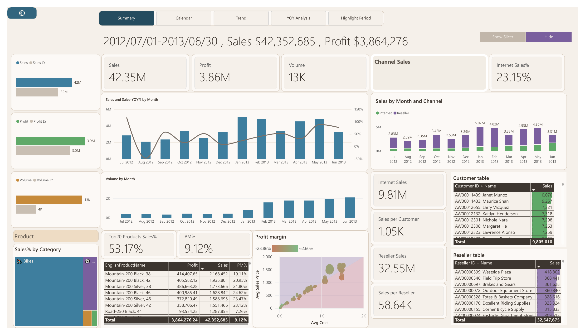
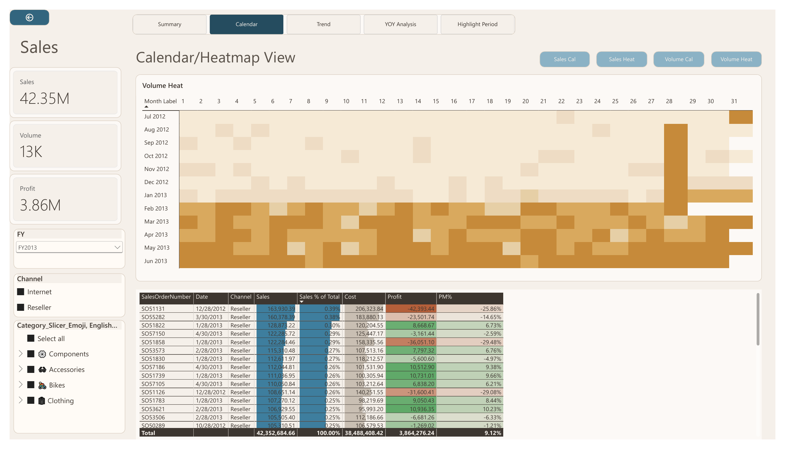
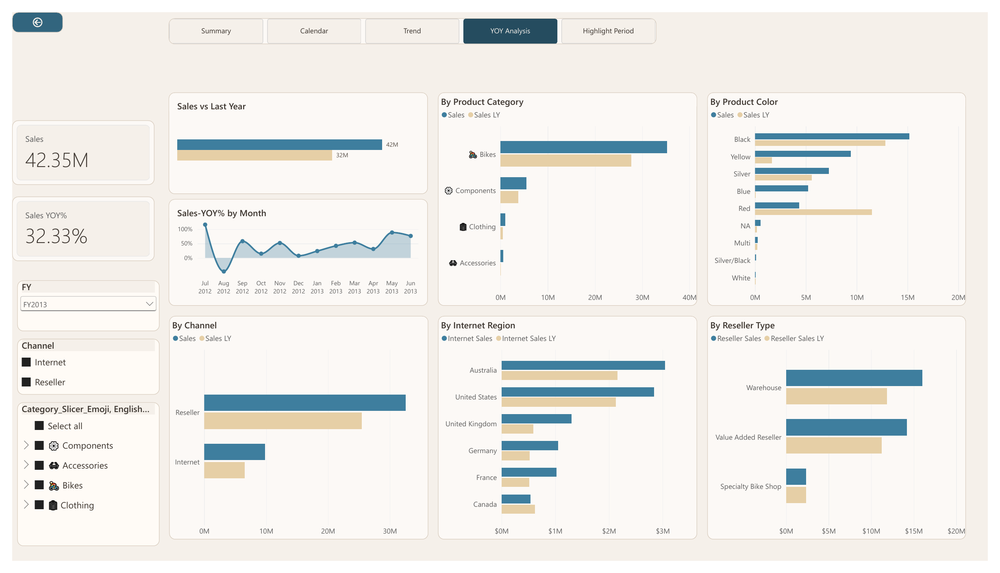
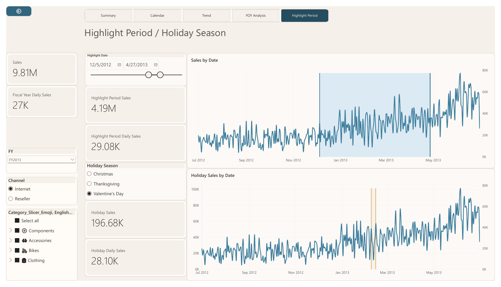

# AdventureWorks Data Analysis

An analytics portfolio project using Microsoft’s fictional AdventureWorks data warehouse to explore sales performance through SQL and Power BI.

## Business questions

The SQL analysis answers 20 questions, including:

- How do Internet and reseller sales perform over time?
- Which products, categories, and territories generate the most sales and gross profit?
- Which customers and resellers contribute the most revenue?
- How do promotions and product discounts relate to sales?
- What are the year-over-year trends, monthly running totals, and top-ranked products or customers?

The first 15 queries use basic SQL. The final five introduce CTEs and window functions.

**SQL file:** [sql/sales_explores.sql](sql/sales_explores.sql)

## Power BI dashboard

The five-page dashboard explores sales, profit, order volume, customers, products, territories, and seasonal patterns.

| Page | Question answered |
|---|---|
| Summary | How are sales, profit, and volume performing compared with last year? |
| Calendar | Which days and weekdays generate the most sales and orders? |
| Trend | How do monthly and recent sales, profit, and volume change over time? |
| YOY Analysis | How do results vary by product, channel, region, and reseller type? |
| Highlight Period | How does a selected date range compare with the rest of the year? |

## Project files

- Power BI report: [powerbi-dashboard/AdventureWorks_Sales_Dashboard.pbix](powerbi-dashboard/AdventureWorks_Sales_Dashboard.pbix)
- PDF dashboard export: [powerbi-dashboard/Adventure_Works.pdf](powerbi-dashboard/Adventure_Works.pdf)
- Custom Power BI theme: [powerbi-dashboard/aw-warm-clay-v2.json](powerbi-dashboard/aw-warm-clay-v2.json)
- SQL analysis: [sql/sales_explores.sql](sql/sales_explores.sql)
- Dashboard screenshots: [images/](images/)

## Notes

AdventureWorks is fictional sample data. The dashboard covers December 2010 to January 2014; several fiscal years are partial, so comparisons should be interpreted with that in mind. Gross profit in the SQL examples is sales less product cost and does not include operating expenses.

**Tools:** SQL Server · Power BI Desktop · DAX · Power Query

**Author:** Muhammad Usama Khan · [LinkedIn](https://linkedin.com/in/u-niazi)
